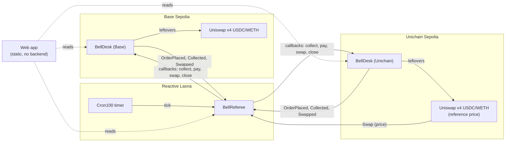
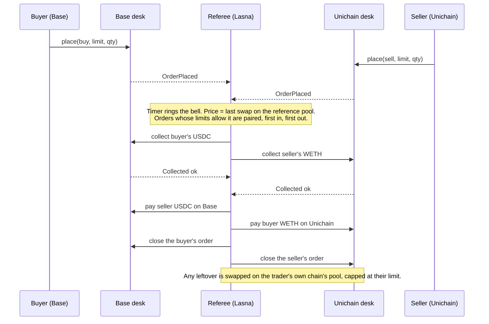

# Bell

Bell swaps ETH and USDC between Base and Unichain with no bridge, and pays both sides 4 to 9 seconds after the bell, measured on every live round we ran.

Built for the Reactive Omni Buildathon 2026, track Every Second Counts · Not affiliated with Reactive Network, Uniswap, Base, Unichain or Circle · App: https://bell-gold-six.vercel.app · Demo: video link added with the submission · Code: https://github.com/CryptoZephyr/bell

Judges, start here: open https://bell-gold-six.vercel.app/#/bell and watch a live round. No wallet, no login, about 2 minutes. Full docs are in [`docs/`](docs/), starting with [`docs/EVIDENCE.md`](docs/EVIDENCE.md).

Testnet only. Nothing here holds real money, and nothing here has been audited.

## How it works, in one paragraph

A trader places an order on the desk contract of their chain. Placing moves no money. One reactive contract on Reactive Lasna, the referee, hears orders from both desks and keeps one book. About every 200 seconds, while orders exist, a timer rings the bell. The referee prices the round from the latest swap on a real Uniswap v4 pool, matches the orders whose limits allow that price, pulls each trader's funds into their desk, and pays each side on the other side's chain. Whatever has no match fills on the Uniswap pool of the trader's own chain, and never past the trader's limit.

## 3 verbs, no wallet or signup needed

| Verb | What it is | Try it without an account |
|---|---|---|
| Watch | The live round: the countdown, the price, the shared book from both chains, and the bell settling in real seconds | https://bell-gold-six.vercel.app/#/bell |
| Verify | Every contract address with explorer links, and what the contracts promise | https://bell-gold-six.vercel.app/#/contracts |
| Learn | How a round works, why you get paid on the other chain, what protection means | https://bell-gold-six.vercel.app/#/help, or the How it works section on https://bell-gold-six.vercel.app |

## More to explore

| Feature | What it is | Where |
|---|---|---|
| Trade | Buy or sell ETH on either chain, with a worst-price limit and press-and-hold to place. Needs a wallet and test funds | https://bell-gold-six.vercel.app/#/trade |
| Activity and receipts | Every order from your wallet, and a receipt per order with each step linked to an explorer | https://bell-gold-six.vercel.app/#/activity |
| Light and dark mode | Follows your device, or pick one in the footer (on a phone, in the account sheet) | Any screen |
| Live evidence | Every testnet gate with its transaction hashes | [`docs/EVIDENCE.md`](docs/EVIDENCE.md) |
| Testing phase results | Every test run on the deployed build, with defects and fixes | [`docs/TESTING_RESULTS.md`](docs/TESTING_RESULTS.md) |
| Contract review | Our own review of both contracts, what we fixed and what we accepted | [`docs/SECURITY_REVIEW.md`](docs/SECURITY_REVIEW.md) |

## Why Reactive is essential

Without Reactive there is no shared book, no bell and no cross-chain settlement. Bell has no server, no keeper and no bot. Turn off every laptop and the rounds keep running.

- No Reactive, no shared book. The referee subscribes to both desks' `OrderPlaced` events and to the reference pool's `Swap` events, and keeps one book across two chains (`contracts/BellReferee.sol`, `configure` and `_onOrderPlaced`).
- No Reactive, no bell. The referee subscribes to Lasna's Cron100 timer when the first order arrives and unsubscribes when the book empties, so the bell costs nothing while the market is quiet (`_onOrderPlaced`, `_bell`, `_finishRound`).
- No Reactive, no settlement. Every pull, payout and pool swap is a Reactive callback to a desk, and the desks accept calls only from the Reactive callback proxy on behalf of the referee (`_clear`, `_settle`, `_callback` in `BellReferee.sol`, and `onlyServiceProvider` in `contracts/BellDesk.sol`).

Each open order also gets its own subscription to the trader's token transfers, so a trader who moves their funds is removed from the book before anyone is asked to pay (`_subscribeTransfer`, `_onTransfer`).

## Architecture

Bell has four layers.

1. Two desks, one on Base Sepolia and one on Unichain Sepolia. They record orders, and move money only when the referee asks through Reactive.
2. One referee on Reactive Lasna. It keeps the book, rings the bell, sets the price, pairs orders and runs the two-step settlement.
3. Two Uniswap v4 USDC/WETH pools, one per chain. The Unichain pool is the price reference, and each pool takes the leftovers on its chain.
4. A static web app. It reads all three chains directly and has no backend.



One round, end to end:



State lives in three places. Orders and the funds of the round being settled sit on the desks. The book, the round and the price sit on the referee. The only thing on a schedule is the Cron100 timer on Lasna, which ticks about every 200 seconds, and the referee only listens to it while orders exist. The app stores only two things, both in your own browser: your theme choice and which wallet you last connected.

## Who holds which key (or permission)

| Role | Lives in | Can | Can never |
|---|---|---|---|
| Trader | Their own wallet | Approve a desk, place an order, cancel it until the desk pulls the funds | Move another trader's funds, or change the round's price |
| Desk | A contract on Base Sepolia and on Unichain Sepolia | Pull, pay, swap, refund and close, only when the Reactive callback proxy calls on behalf of the referee | Pull more than an order committed to, or act on a call from anyone else |
| Referee | A reactive contract on Reactive Lasna | Keep the book, set the price, pair orders, and ask the desks to move money | Touch funds directly, or change its desks or pool after the one-time `configure` |
| Reactive callback proxy | Reactive Network, on each desk chain | Deliver the referee's callbacks to the desks | Call a desk for any contract other than the referee (the desk checks the sender) |
| Deployer key | `BELL_PRIVATE_KEY`, on the deployer's machine only | Deploy, run `configure` once, withdraw REACT from the referee's own balance | Call any money function on a desk. The desks have no owner and no admin |

## Safety

- The desk never pulls more than an order committed to: a buyer's cost at their own limit, or a seller's quantity, counted across every pull for that order (`collect` in `BellDesk.sol`, and the test "rejects a buyer pull above the cost at the order's own limit, even with a huge approval").
- A leftover fills on the pool only up to the trader's limit, after the pool fee. Whatever the pool can't fill inside the limit comes straight back in the same transaction (tests "a buyer remainder stops at the cap, returns the unused USDC, and stays inside the limit", and the seller version).
- The desk refuses an order the trader can't pay for right now, and any order under 0.00001 ETH, so spam orders cost the referee nothing (`place`, tests "needs approval and balance for the cost at the order's own limit price" and "rejects dust orders and values too large for the referee").
- The book holds at most 6 orders, and one wallet at most 2. An order leaves the book after 15 minutes. These are constants in `BellReferee.sol` (`MAX_BOOK`, `MAX_ORDERS_PER_TRADER`, `ORDER_TTL`).
- If the price moves more than 10% within one bell window, the round is skipped and no money moves (`DRIFT_BPS`, test "skips the round when the pool price drifts more than 10% from the open price").
- If one pull fails, only that order drops, and everyone else settles in the same round. If a delivery is lost, the round expires after 300 seconds and every desk refunds from its own record (tests "a lost delivery: survivors settle on the expiry bell, and the missing order is frozen and refunded" and "refunds pulls whose desk events were lost, then freezes those orders").
- A settled or refunded order is frozen, so it can never be pulled again (test "a settled order is frozen, so it can never be pulled or cancelled again").
- The app says Paid only after the payout transaction is confirmed on the trader's chain, and never from desk bookkeeping or the Lasna settle event (`frontend/src/chain/payouts.ts`, `frontend/tests/paid-truth.mjs`, 26 checks).
- 40 random books across both chains keep every desk balanced and send no payout to a wrong address (test "random books keep the books balanced").

What isn't solved is written down in [`docs/SECURITY_REVIEW.md`](docs/SECURITY_REVIEW.md). The two biggest gaps: a funded wallet can still place and cancel in a loop and drain the referee's REACT, and the price is one thin pool's last swap.

## What's real and what's simulated

| Real | Simulated |
|---|---|
| Circle's testnet USDC and canonical WETH on Base Sepolia and Unichain Sepolia | Nothing in the app or the demo |
| Real Uniswap v4 pools and swaps on both chains | The liquidity in those pools is ours, put there for testing. It is not market depth |
| Reactive Lasna subscriptions, timer and callbacks, paid for in REACT | In local unit tests only, a stand-in for the Reactive system contract and callback proxy (`contracts/test/`). Nothing deployed uses it |
| Every number the app shows, read from the three chains | |
| Every claim in `docs/`, backed by a transaction hash | |

## Tech stack

Solidity 0.8.29 and 0.8.26 (Cancun) · Hardhat 2 with ethers v6 · reactive-lib-omni · Uniswap v4 core · React 18 and Vite 5 · viem · TypeScript · Playwright and axe-core for tests · Vercel for hosting.

## Run it locally

```bash
git clone --recurse-submodules https://github.com/CryptoZephyr/bell.git
cd bell/frontend && npm ci
npm run dev
```

That opens the app at http://localhost:5173 against the live testnet contracts, with zero keys. Everything you can do on the hosted app works, including trading with your own wallet. To run the contract tests, run `npm install` and then `npx hardhat test` at the repo root (79 tests, also no keys).

| Variable | What it enables |
|---|---|
| `BELL_PRIVATE_KEY` | Deploying contracts and running the live test scripts in `scripts/`. A funded testnet key, set in your shell, never committed |
| `AMOUNT` | How much REACT `scripts/fund-reserves.js` deposits for the referee |

The app itself needs no environment variables. It reads its addresses from `deployments/bell.json` at build time.

## Deploying

The app is a static Vite build, hosted on Vercel with `frontend` as the root directory. Every push to the main branch deploys to production, and every pull request gets a preview.

The contracts deploy in a fixed order, because the desks need the referee's address and the referee needs the desks':

```bash
STAGE=referee npx hardhat run scripts/deploy.js --network lasna
STAGE=desk:baseSepolia npx hardhat run scripts/deploy.js --network baseSepolia
STAGE=desk:unichainSepolia npx hardhat run scripts/deploy.js --network unichainSepolia
STAGE=configure npx hardhat run scripts/deploy.js --network lasna
AMOUNT=1.0 npx hardhat run scripts/fund-reserves.js --network lasna
```

After that, keep at least 1 REACT in the referee's reserves, because a reactive contract in debt stops hearing events. `scripts/watch-reserves.js` checks the floor and exits non-zero when reserves are low, so a cron job can raise the alarm. `scripts/align-pools.js` brings both pools back to the same price before a demo.

## Proof it works

One round on the deployed contracts, on 18 Nov 2026. A seller on Base and a buyer on Unichain were paired at 799.90 USDC per ETH. The buyer's leftover filled on the Unichain pool.

| Time (UTC) | Chain | What happened | Transaction |
|---|---|---|---|
| 09:58:30 | Reactive Lasna | The bell rang: 2 orders in, 1 pair | [`0x5aec5411…d34a8d`](https://lasna.reactscan.net/tx/0x5aec54115b6d96498c9b943725966e6fc7f26a54d9ce803b782d39baebd34a8d) |
| 09:58:32 | Base Sepolia | The seller's 0.0003 WETH collected | [`0x38b88ed9…2aa8ad`](https://sepolia.basescan.org/tx/0x38b88ed926fb0a5545b9e146cdf95ce6aa8ba4aa9103f14189de4e85d92aa8ad) |
| 09:58:32 | Reactive Lasna | Settled | [`0x4e47bbc2…4b89`](https://lasna.reactscan.net/tx/0x4e47bbc29fabee76c706402706a0b137d258a503b2009c5f60f49b4dd0de4b89) |
| 09:58:33 | Unichain Sepolia | The buyer's 0.319961 USDC collected | [`0x448f4007…ba90cb`](https://sepolia.uniscan.xyz/tx/0x448f400799dee1b878f1957836f1a6301eeb2bce1bc26f7eb639943e67ba90cb) |
| 09:58:34 | Base Sepolia | The buyer was paid 0.0003 WETH on Base | [`0x563a6c5a…632d06`](https://sepolia.basescan.org/tx/0x563a6c5a56363933816aab455fd508d75648ccc22b668edc53bfb99a29632d06) |
| 09:58:35 | Unichain Sepolia | The seller was paid 0.239970 USDC on Unichain | [`0x16937232…033064`](https://sepolia.uniscan.xyz/tx/0x169372323efa806032cb66c2b4dd1ca60b1468ea755487e8f4229a3748033064) |
| 09:58:35 | Unichain Sepolia | The buyer's leftover 0.079991 USDC swapped on the pool for 0.0000999 WETH | [`0x2e8dade3…e43c76`](https://sepolia.uniscan.xyz/tx/0x2e8dade3f11feaac355ac4f3ce369330d2b2e578131e31fa43c281b447e43c76) |

Bell to last payout: 5 seconds. The testing phase then ran three clean demo rounds in a row on the fixed build, with every ticket turning Paid only after its payout landed. Those runs, and every other test, are in [`docs/TESTING_RESULTS.md`](docs/TESTING_RESULTS.md).

## Repository map

```
contracts/
  BellDesk.sol          one desk per chain: orders, pulls, payouts, pool swaps
  BellReferee.sol       the reactive contract: book, bell, price, pairing, settlement
  test/                 stand-ins used only by the local tests
test/                   Hardhat tests for both contracts (79)
deployments/            address records: bell.json is current, older versions kept
scripts/                deploy, fund reserves, align pools, live rounds, latency, reserve watch
frontend/
  src/chain/            reads from the three chains: rounds, orders, payouts, receipts
  src/screens/          Landing, Bell, Trade, Activity, Receipt, Contracts and proof, Help
  src/ui/               the living mark, bell card, ticket, buttons, sheets
  src/styles/           design tokens and styles, light and dark
  tests/                axe, keyboard, stages, end-to-end and paid-truth tests
docs/                   evidence, security review, frontend audit, testing results
vendor/reactive-lib-omni  the Reactive library, pinned as a git submodule
```

## Pre-existing work and credits

Everything in this repository was built during the buildathon, starting 17 Nov 2026. That covers both contracts, the web app, the scripts, the tests, the design system and the logo. A private spike repository from the same week proved each mechanism first, and no code was copied from it.

The idea of single-price clearing comes from Cleara (Colosseum, Solana). No code from it is used.

Libraries, used as dependencies and not modified:

| Library | Use | License |
|---|---|---|
| reactive-lib-omni (Reactive Network) | Base contracts for the referee and desks, pinned at commit 3ade0dc | See its repository |
| Uniswap v4 core | PoolManager interfaces, and the PoolSwapTest and PoolModifyLiquidityTest helpers used only by our scripts | BUSL-1.1 |
| viem | Chain reads and writes in the app | MIT |
| React, Vite | The app | MIT |
| Hardhat, ethers | Contract build, tests and deploys | MIT |
| Schibsted Grotesk, Spline Sans Mono | Typefaces, self-hosted | SIL Open Font License |
| Playwright, axe-core | Browser and accessibility tests | Apache-2.0, MPL-2.0 |

## License and disclaimers

MIT, as declared in `package.json`. The libraries above keep their own licenses.

Bell runs on testnets only and holds no real money. The contracts haven't been audited. Our own review is in [`docs/SECURITY_REVIEW.md`](docs/SECURITY_REVIEW.md). Don't deploy this to mainnet as it is.

Bell is not affiliated with or endorsed by Reactive Network, Uniswap Labs, Base, Unichain or Circle. Their names are used only to describe what Bell runs on.

Retired test deployments still hold funds that can't be recovered: 0.806315 USDC on the v2 Base desk, and 0.001 WETH on each v2 desk. That's testnet money only.
