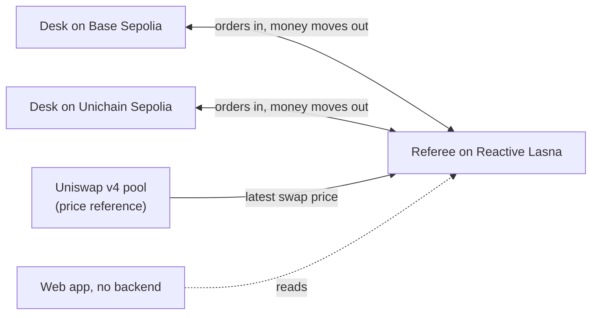
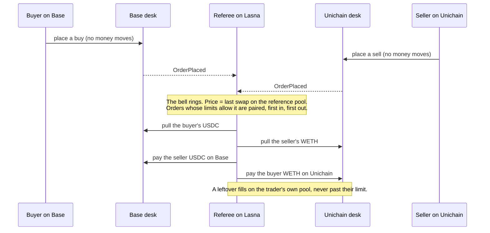

# Bell

Bell swaps ETH and USDC across Base and Unichain by pairing you with a trader on the other chain instead of a bridge, and pays both sides about 5 seconds after the bell.

Built for the Reactive Omni Buildathon 2026, track Every Second Counts · Not affiliated with Reactive Network, Uniswap, Base, Unichain or Circle · App: https://bell-gold-six.vercel.app · Code: https://github.com/CryptoZephyr/bell
<!-- Add "· Demo: <video link>" to the line above once the video is up. -->

 start here: [the 2 minute tour](#2-verbs-no-wallet-or-signup-needed) Full docs at [`docs/`](docs/).

## 2 verbs

| Verb | What it is | Try it without an account |
|---|---|---|
| Check | Every bell on the deployed contracts, newest first, with the real seconds each one took from the bell to the last payout. It works at any hour and needs no wallet. Each round links to its transactions on the block explorers. One round is walked through in [Proof it works](#proof-it-works) and on its own page at https://bell-gold-six.vercel.app/#/round/8643401 | https://bell-gold-six.vercel.app/#/rounds |
| Watch | The live round: the countdown to the next bell, the Uniswap price, one book holding orders from both chains, and each chain's payout landing. If a round settled in the last 10 minutes or so, the page also shows it with its real timings and explorer links. Otherwise it reads "Market quiet", so start with Check | https://bell-gold-six.vercel.app/#/bell |

## More to explore

| Feature | What it is | Where |
|---|---|---|
| Trade | Buy or sell ETH on either chain with a worst-price limit, placed by press and hold. Needs a wallet and test funds | https://bell-gold-six.vercel.app/#/trade |
| Rounds | The record behind Check: a speed summary, a seconds strip and one page per round with its split sheet and ledger. Seconds come from block timestamps, and a chain whose logs can't be read says so instead of showing a number | https://bell-gold-six.vercel.app/#/rounds |
| Receipts | Each order's result, the chain it was paid on, and every step linked to an explorer | https://bell-gold-six.vercel.app/#/activity |
| Contracts and proof | The three contract addresses with explorer links, and what the contracts promise | https://bell-gold-six.vercel.app/#/contracts |
| Help | Why you're paid on the other chain, what protection means, how to get test funds | https://bell-gold-six.vercel.app/#/help |
| Live evidence | Every testnet gate with its transaction hashes | [`docs/EVIDENCE.md`](docs/EVIDENCE.md) |
| Testing results | Every test of the deployed build, with the defects found and fixed | [`docs/TESTING_RESULTS.md`](docs/TESTING_RESULTS.md) |
| Device checklist | Steps for testing on real phones, wallet apps and screen readers | [`docs/DEVICE_TEST_CHECKLIST.md`](docs/DEVICE_TEST_CHECKLIST.md) |
| Contract review | Our own review of both contracts: what we fixed and what we accepted | [`docs/SECURITY_REVIEW.md`](docs/SECURITY_REVIEW.md) |

## Why Reactive is essential

Moving value between chains today takes a bridge and then a swap, or a solver who fronts their own money on the other chain and charges for it. Bell needs neither, because Reactive is the exchange. Without Reactive there is no shared book, no bell and no settlement across two chains. There is no server, keeper or bot. Turn off every laptop and the rounds keep running, as long as the referee has REACT to pay for its reactions. We ran it out of REACT on purpose: the app showed the bell as paused, and Bell recovered after a top-up.

- No Reactive, no shared book. The referee subscribes to both desks' `OrderPlaced` events and keeps one book across two chains. It also watches each trader's token transfers while their order is open, and removes the order if the funds move (`contracts/BellReferee.sol`: `configure`, `_onOrderPlaced`, `_onTransfer`).
- No Reactive, no bell. The referee listens to Lasna's Cron100 timer only while orders exist, so a quiet market costs nothing (`_onOrderPlaced`, `_bell`, `_finishRound`).
- No Reactive, no settlement. Every pull, payout and pool swap is a Reactive callback, and the desks refuse calls from anyone but the Reactive callback proxy acting for the referee (`_settle` and `_callback` in `BellReferee.sol`, `onlyServiceProvider` in `contracts/BellDesk.sol`).

## Architecture

- Desks: one contract on Base Sepolia and one on Unichain Sepolia. They record orders and move money only when the referee asks through Reactive.
- Referee: one reactive contract on Reactive Lasna. It keeps the book, rings the bell, sets the price, pairs orders and settles the round.
- Pools: a real Uniswap v4 USDC/WETH pool on each chain. The Unichain pool sets the price, and each pool takes the leftovers on its chain.
- App: a static web app that reads all three chains directly, with no backend.



One round, end to end:



Orders, and the funds of a round while it settles, sit on the desks. The book and the price sit on the referee. The one schedule is Lasna's Cron100 timer, about every 110 seconds (100 Lasna blocks), and the referee only listens to it while orders exist. The app keeps nothing on a server. Your browser remembers only your theme and the wallet you last used.

## Who holds which key (or permission)

| Role | Lives in | Can | Can never |
|---|---|---|---|
| Trader | Their own wallet | Approve a desk, place an order, cancel it until the desk pulls the funds | Move another trader's funds, or set the price |
| Desk | A contract on each desk chain | Pull, pay, swap, refund and close, only when the Reactive callback proxy calls for the referee | Pull more than an order committed to, or obey anyone else |
| Referee | A reactive contract on Reactive Lasna | Keep the book, set the price, pair orders, ask the desks to move money | Touch funds itself, or change its desks or pool after the one-time `configure` |
| Reactive callback proxy | Reactive Network, on each desk chain | Deliver the referee's callbacks | Make a desk act for any contract other than the referee |
| Deployer key | `BELL_PRIVATE_KEY`, on the deployer's machine | Deploy, run `configure` once, withdraw REACT from the referee | Call a desk's money functions. The desks have no owner and no admin |

## Safety

Every limit below is enforced in the contracts or the app and covered by a test.

| Rule | Enforced in | Proven by |
|---|---|---|
| A desk never pulls more than the order committed to | `BellDesk.collect` | "rejects a buyer pull above the cost at the order's own limit" |
| A leftover fills only inside the trader's limit, after the pool fee. The rest comes back in the same transaction | `BellDesk.swapBuy`, `swapSell` | "a buyer remainder stops at the cap", and the seller version |
| An order the trader can't pay for, or under 0.00001 ETH, is refused before it costs anything | `BellDesk.place` | "needs approval and balance", "rejects dust orders" |
| At most 6 orders in the book and 2 per wallet. An order expires after 15 minutes | `MAX_BOOK`, `MAX_ORDERS_PER_TRADER`, `ORDER_TTL` | live drops in [`docs/EVIDENCE.md`](docs/EVIDENCE.md) |
| A price jump over 10% inside one bell skips the round, and no money moves | `DRIFT_BPS` | "skips the round when the pool price drifts more than 10%" |
| One failed pull drops only that order. Everyone else settles in the same round | `_resolvePulls` | live round C-11 in [`docs/TESTING_RESULTS.md`](docs/TESTING_RESULTS.md) |
| A lost delivery expires after 300 s, and every desk refunds from its own records | `PULL_TIMEOUT`, `refundOrder` | "a lost delivery: survivors settle on the expiry bell" |
| A finished order is frozen and can never be pulled again | `closeOrder`, `refundOrder` | "a settled order is frozen" |
| The app shows Paid only after the payout is confirmed on the chain | `frontend/src/chain/payouts.ts` | `frontend/tests/paid-truth.mjs`, 31 checks |
| Random books across both chains keep every desk balanced | both contracts | "random books keep the books balanced", 40 books |

Two risks remain open, and [`docs/SECURITY_REVIEW.md`](docs/SECURITY_REVIEW.md) explains both. A funded wallet can place and cancel in a loop and drain the referee's REACT. And the price is the last swap of one thin pool.

## What's real and what's simulated

| Real | Simulated |
|---|---|
| Circle's testnet USDC and canonical WETH on both chains | Nothing in the app or the demo |
| Uniswap v4 pools and swaps on both chains | The pools' liquidity is ours, added for testing. It is not market depth |
| Reactive Lasna subscriptions, timer and callbacks, paid in REACT | A stand-in for the Reactive system contract, used only by the local unit tests in `contracts/test/` |
| Every number in the app, read from the chains, and every claim in `docs/`, backed by a transaction | |

## Tech stack

Solidity · Hardhat · reactive-lib-omni · Uniswap v4 · React · Vite · viem · TypeScript · Playwright · axe-core · Vercel.

## Run it locally

```bash
git clone --recurse-submodules https://github.com/CryptoZephyr/bell.git
cd bell/frontend && npm ci
npm run dev
```

This runs the app at http://localhost:5173 against the live testnet contracts, with zero keys. Everything works, including trading from your own wallet. The contract tests need no keys either: run `npm install` and `npx hardhat test` at the repo root (79 tests).

| Variable | What it enables |
|---|---|
| `BELL_PRIVATE_KEY` | Deploying the contracts and running the live scripts in `scripts/`. A funded testnet key, kept in your shell and never committed |
| `AMOUNT` | How much REACT `scripts/fund-reserves.js` deposits for the referee |

## Deploying

The app is a static Vite build on Vercel, with `frontend` as the root directory. Each push to the default branch goes to production, and every other branch gets a preview.

The contracts go out in this order, because each side needs the other's address:

```bash
STAGE=referee npx hardhat run scripts/deploy.js --network lasna
STAGE=desk:baseSepolia npx hardhat run scripts/deploy.js --network baseSepolia
STAGE=desk:unichainSepolia npx hardhat run scripts/deploy.js --network unichainSepolia
STAGE=configure npx hardhat run scripts/deploy.js --network lasna
AMOUNT=1.0 npx hardhat run scripts/fund-reserves.js --network lasna
```

Keep at least 1 REACT in the referee's reserves. A reactive contract in debt stops hearing events. `scripts/watch-reserves.js` exits with an error when reserves run low, so a cron job can raise the alarm, and `scripts/align-pools.js` brings both pools to the same price before a demo. The addresses live in `deployments/bell.json`, and the app reads them from there.

## Proof it works

One round on the deployed contracts, 18 Nov 2026. A seller on Base and a buyer on Unichain were paired at 799.90 USDC per ETH. Bell to last payout: 5 seconds. The same round on the Rounds page, with its split sheet and every transaction: https://bell-gold-six.vercel.app/#/round/8643401

| Time (UTC) | Chain | What happened | Transaction |
|---|---|---|---|
| 09:58:30 | Reactive Lasna | The bell rang: 2 orders in, 1 pair | [`0x5aec5411…d34a8d`](https://lasna.reactscan.net/tx/0x5aec54115b6d96498c9b943725966e6fc7f26a54d9ce803b782d39baebd34a8d) |
| 09:58:32 | Base Sepolia | Pulled the seller's 0.0003 WETH | [`0x38b88ed9…2aa8ad`](https://sepolia.basescan.org/tx/0x38b88ed926fb0a5545b9e146cdf95ce6aa8ba4aa9103f14189de4e85d92aa8ad) |
| 09:58:33 | Unichain Sepolia | Pulled the buyer's 0.319961 USDC | [`0x448f4007…ba90cb`](https://sepolia.uniscan.xyz/tx/0x448f400799dee1b878f1957836f1a6301eeb2bce1bc26f7eb639943e67ba90cb) |
| 09:58:34 | Base Sepolia | Paid the buyer 0.0003 WETH on Base | [`0x563a6c5a…632d06`](https://sepolia.basescan.org/tx/0x563a6c5a56363933816aab455fd508d75648ccc22b668edc53bfb99a29632d06) |
| 09:58:35 | Unichain Sepolia | Paid the seller 0.239970 USDC on Unichain | [`0x16937232…033064`](https://sepolia.uniscan.xyz/tx/0x169372323efa806032cb66c2b4dd1ca60b1468ea755487e8f4229a3748033064) |
| 09:58:35 | Unichain Sepolia | Filled the buyer's leftover 0.079991 USDC on the pool | [`0x2e8dade3…e43c76`](https://sepolia.uniscan.xyz/tx/0x2e8dade3f11feaac355ac4f3ce369330d2b2e578131e31fa43c281b447e43c76) |

Every round since, with its seconds, is on the [Rounds page](https://bell-gold-six.vercel.app/#/rounds). Every live round in the testing phase paid out 4 to 6 seconds after the bell with one or two pairs, and 8 to 9 seconds with a full book of 6 orders. The three demo runs and every other test are in [`docs/TESTING_RESULTS.md`](docs/TESTING_RESULTS.md).

It also works for someone outside the build. On 18 Nov 2026 the project owner placed a buy of 0.0001 ETH on Base from their own wallet in the hosted app. The bell rang 13 seconds later ([`0xc41d840c…eff800`](https://lasna.reactscan.net/tx/0xc41d840cb06d72d7513b8845d95a3b2a78a53e7e8ac9b6103a7e6a675beff800)), the desk collected 0.078519 USDC, and the Base pool paid out 0.0000986726 WETH 4 seconds after the bell.

## Next steps

Price averaging is not built. The bell prices a round at the last swap on the reference Uniswap pool and skips the round if that price moved more than 10 percent inside one window. A time-weighted average over a short window would make the price harder to move with one trade. It is the first thing to add before this goes beyond testnets.

## Repository map

```
contracts/BellDesk.sol       one desk per chain: orders, pulls, payouts, pool swaps
contracts/BellReferee.sol    the reactive contract: book, bell, price, pairing, settlement
contracts/test/              stand-ins for the local tests only
test/                        contract tests (79)
deployments/                 address records, bell.json is current
scripts/                     deploy, fund reserves, align pools, live rounds, reserve watch
frontend/src/chain/          reads the three chains: rounds, orders, payouts, receipts
frontend/src/screens/        Landing, Bell, Trade, Activity, Receipt, Contracts and proof, Help
frontend/src/ui/             the living mark, bell card, tickets, buttons, sheets
frontend/tests/              accessibility, keyboard, end-to-end and paid-truth tests
docs/                        evidence, security review, frontend audit, testing results
vendor/reactive-lib-omni/    the Reactive library, pinned as a git submodule
```

## Pre-existing work and credits

Everything here was built during the buildathon, from 17 Nov 2026: both contracts, the app, the scripts, the tests, the design system and the logo. A private spike repository from the same week proved each mechanism first. No code was copied from it. Single-price clearing comes from Cleara (Colosseum, Solana) as an idea, with no code reused.

| Library | Use | License |
|---|---|---|
| reactive-lib-omni | Base contracts for the referee and desks, unmodified, pinned at 3ade0dc | Marked UNLICENSED in its source headers |
| Uniswap v4 core | Pool interfaces, plus swap and liquidity helpers used only by our scripts | BUSL-1.1 |
| viem, React, Vite, Hardhat, ethers | The app, the build and the tests | MIT |
| Schibsted Grotesk, Spline Sans Mono | Typefaces, self-hosted | SIL Open Font License |
| Playwright, axe-core | Browser and accessibility tests | Apache-2.0, MPL-2.0 |

## License and disclaimers

MIT. See [`LICENSE`](LICENSE). Each library keeps its own license.

Testnet only. Bell holds no real money and hasn't been audited, so don't deploy it to mainnet as it stands. Bell isn't affiliated with or endorsed by Reactive Network, Uniswap Labs, Base, Unichain or Circle. Their names describe only what Bell runs on.
